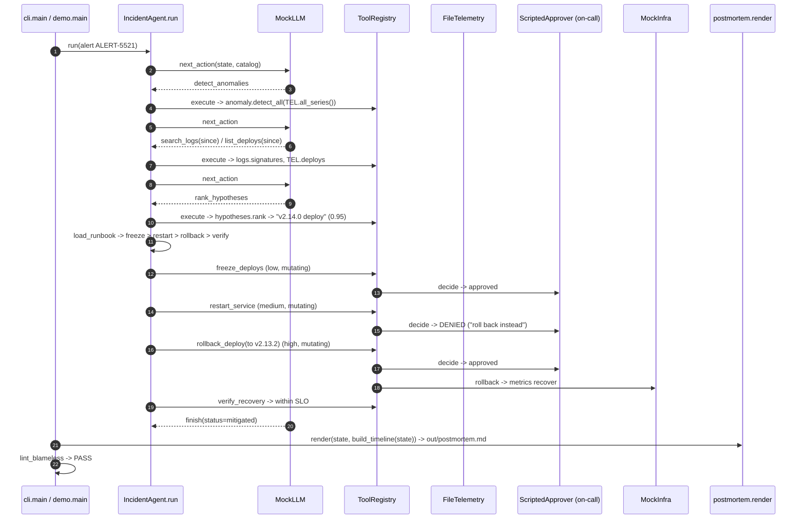

# Architecture · 29 SRE Incident Agent

## Components

| Layer | Component | File | Responsibility |
|---|---|---|---|
| entry | `main` | `src/sre_agent/cli.py` | Argparse (`--interactive`); used by `demo.py` and the `sre-agent` script. |
| entry | `demo.main` | `src/sre_agent/demo.py` | Wires telemetry, infra, approver and LLM; prints the trace, hypotheses, timeline and postmortem. |
| config | `Settings` | `src/sre_agent/config.py` | `LLM_PROVIDER`, `LLM_MODEL`, API keys, `SRE_EXAMPLES_DIR`, `SRE_OUT_DIR`, `SRE_MAX_STEPS`. |
| service | `IncidentAgent.run` | `src/sre_agent/services/agent.py` | Think → act → observe loop over `AgentState`; loads the runbook for the top hypothesis. |
| service | `ToolRegistry`, `build_toolbox` | `src/sre_agent/services/tools.py` | Tool catalog with risk levels; **enforces approval** for every mutating tool. |
| service | `detect_all` | `src/sre_agent/services/anomaly.py` | Robust (median/MAD) z-score with a sustain window. |
| service | `signatures` | `src/sre_agent/services/logs.py` | Groups WARN/ERROR logs into templates (numbers, ids stripped). |
| service | `rank` | `src/sre_agent/services/hypotheses.py` | Scores deploy, traffic and dependency hypotheses with explicit `Evidence` weights. |
| service | `build_timeline`, `render`, `lint_blameless` | `src/sre_agent/services/timeline.py`, `postmortem.py` | Incident timeline and blameless postmortem, linted for blame language. |
| domain | models, `AgentState` | `src/sre_agent/domain/` | `Alert`, `Anomaly`, `Hypothesis`, `Evidence`, `Risk`, `Action`, `ActionRecord`, ... |
| adapter | `FileTelemetry`, `load_alert` | `src/sre_agent/adapters/telemetry.py` | Metrics, logs, deploys, services from `examples/incident/`. |
| adapter | `MockInfra` | `src/sre_agent/adapters/infra.py` | A fake production that mutating tools really change (rollback fixes the metrics). |
| adapter | `ScriptedApprover`, `ConsoleApprover`, `DenyAll` | `src/sre_agent/adapters/approval.py` | Who says yes. The agent never approves itself. |
| adapter | `MockLLM`, `RealLLM`, `default_llm` | `src/sre_agent/adapters/llm.py` | Deterministic SRE policy; a real model can propose actions and falls back to the policy on any error. |
| adapter | `SimClock` | `src/sre_agent/adapters/clock.py` | Simulated incident time (14:12 onwards) without waiting. |

## Data flow

The alert seeds an `AgentState`. Each turn the LLM reads the state and the tool catalog and proposes one `Action`.
`ToolRegistry.execute` validates it, asks the approver if the tool is mutating, runs it, and returns an
`ActionRecord` (executed / denied / failed). `IncidentAgent._absorb` copies results into the state (anomalies,
signatures, deploys, hypotheses, verified, paged), which is all the LLM sees next turn. After `finish`, the
records become a timeline and a postmortem.

## One full request: ALERT-5521

## Design decisions

- **The LLM proposes, the registry disposes.** Approval is enforced in `ToolRegistry.execute`, not in the prompt,
  so a confused or prompt-injected model still cannot mutate production without a human "yes".
- **Risk is metadata on the tool.** Read-only tools run freely; every mutating tool has a risk level and a
  human-readable preview shown to the approver.
- **Evidence, not vibes.** Hypotheses carry weighted `Evidence` lines (timing, matching log keywords, affected
  services), so the on-call can see why the agent believes the deploy is the cause.
- **Runbooks are data.** `examples/runbooks.json` maps a hypothesis kind to steps with `{placeholders}`; ops can edit
  them without touching code.
- **Denial is information.** A denied step is recorded and the agent moves on to the next runbook step; if the
  runbook runs out without recovery it pages a human instead of claiming success.
- **Settings in one place.** `config.Settings` feeds the LLM factory, data paths and step budget.

## Failure modes and how they are handled

| Failure | Handling |
|---|---|
| Flapping alert (no sustained anomaly) | Agent finishes with `status=no_anomaly`. |
| Model proposes an unknown tool or misses args | Recorded as `failed`; nothing runs. |
| Human denies a step | Recorded as `denied`; next runbook step or escalation. |
| No approver configured | `DenyAll`: nothing mutating runs. |
| Runbook exhausted, still unhealthy | `page_oncall`, then `finish(status=escalated)`. |
| Agent loops | `SRE_MAX_STEPS` budget → `status=step_limit`. |
| Real LLM errors or returns junk | `RealLLM` falls back to the `MockLLM` policy for that turn. |
| Postmortem blames a person | `lint_blameless` flags it (demo prints PASS/FAIL). |

## How to extend

- **New tool:** add a function in `build_toolbox`, register a `Tool(name, description, params, risk, mutating, fn)`.
- **New hypothesis kind:** add a scorer in `hypotheses.py` and a matching runbook in `examples/runbooks.json`.
- **Real telemetry:** implement the `FileTelemetry` methods (`all_series`, `logs`, `deploys`) against Prometheus / Loki.
- **Real approvals:** write an `Approver` that posts to Slack and waits for a button click.
