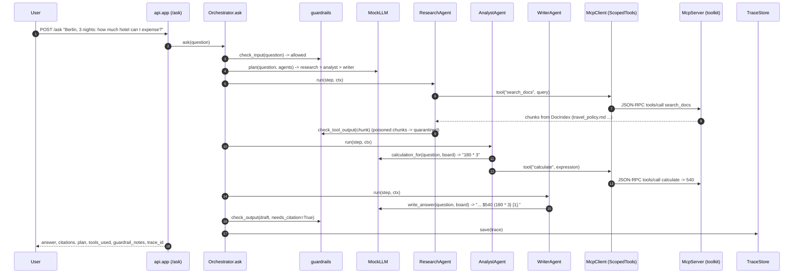

# Architecture · 30 Enterprise Multi-Agent Capstone

## Components

| Layer | Component | File | Responsibility |
|---|---|---|---|
| entry | `main`, `run_evals` | `src/capstone/cli.py` | `demo`, `evals`, `serve`, `mcp-stdio`; used by `demo.py`, `run_evals.py` and the `capstone` script. |
| entry | `demo.main` | `src/capstone/demo.py` | MCP discovery over HTTP, five traced questions, eval summary. |
| config | `Settings` | `src/capstone/config.py` | Provider, model, keys, `DOCS_DIR`, `EVALS_FILE`, `TRACE_FILE`, `ORCHESTRATOR_MAX_STEPS`, host/port. |
| wiring | `build`, `System` | `src/capstone/container.py` | Composition root: index, tool server, MCP client, LLM, specialists, trace store. |
| http | `create_app` | `src/capstone/api/app.py` | FastAPI: `/ask`, `/mcp` (JSON-RPC), `/tools`, `/traces/{id}`, `/healthz`. |
| service | `Orchestrator.ask` | `src/capstone/services/orchestrator.py` | Input guard → LLM plan → specialists in order → output guard → `AskResponse`. |
| service | `ResearchAgent`, `AnalystAgent`, `OpsAgent`, `WriterAgent` | `src/capstone/services/agents.py` | Specialists, each with an allow-list of tools, sharing a `Blackboard`. |
| service | `build_tool_server`, `TicketDesk` | `src/capstone/services/toolkit.py` | MCP tools: `search_docs`, `calculate` (safe AST eval), `create_ticket`. |
| service | `DocIndex` | `src/capstone/services/rag.py` | Markdown chunking + TF-IDF search with section-level citations. |
| service | `check_input`, `check_tool_output`, `check_output` | `src/capstone/services/guardrails.py` | Injection detection, PII redaction, quarantine of poisoned chunks, citation check. |
| service | `TraceStore`, `Trace` | `src/capstone/services/tracing.py` | Nested spans per request; optional JSONL sink. |
| service | `run_suite`, `report` | `src/capstone/services/evals.py` | Eval cases with contains / not-contains / cited / blocked / tools / source checks. |
| adapter | `McpServer`, `McpClient`, `ScopedTools`, transports | `src/capstone/adapters/mcp.py` | JSON-RPC 2.0 tool protocol; in-process and HTTP transports; per-agent scoping. |
| adapter | `mcp_stdio.main` | `src/capstone/adapters/mcp_stdio.py` | Same tools over stdio, one message per line. |
| adapter | `MockLLM`, `RealLLM`, `default_llm` | `src/capstone/adapters/llm.py` | Rule-based planner/writer; real provider for plan + answer with fallback. |

## Data flow

A question enters through `/ask`. `guardrails.check_input` blocks injections and redacts PII. The LLM produces a
`Plan` (ordered specialist steps, always ending with `writer`). Each specialist gets an `AgentContext` whose
`ScopedTools` only exposes its allowed tools, all called over JSON-RPC through `McpClient`. Results land on the
shared `Blackboard` (findings, quarantined chunks, calculation, ticket, draft). `check_output` redacts PII and
checks citations, and every step is a span in the request's `Trace`.

## One full request

## Design decisions

- **Agents speak only JSON-RPC.** The orchestrator and specialists never import a tool; tools could move to another
  process (`capstone mcp-stdio`) or service without changing agent code.
- **Least privilege per agent.** `ScopedTools` enforces each specialist's allow-list; only `OpsAgent` can change
  anything (`create_ticket`), and the writer has no tools at all.
- **Guard every boundary.** Input (injection, PII), tool output (retrieved text is untrusted data), and final output
  (PII, citations) are checked by deterministic code, not by asking the model nicely.
- **Blackboard, not chat history.** Specialists share structured state, which keeps prompts small and the trace readable.
- **Evals as a gate.** `run_evals.py` exits non-zero on any regression; docker compose has a `ci` profile for it.
- **Settings in one place.** `config.Settings` feeds `build`, `serve.py`, the CLI and the stdio server; explicit
  `build()` arguments still win, which is how tests inject `MockLLM` and fixture paths.

## Failure modes and how they are handled

| Failure | Handling |
|---|---|
| Prompt injection in the question | `check_input` blocks it; canned refusal, `blocked=True`. |
| Poisoned document in retrieval | `check_tool_output` quarantines the chunk; it never reaches the writer. |
| PII in the question or answer | Redacted by `redact`; a guardrail note explains what happened. |
| Agent calls a tool outside its allow-list | `PermissionError` from `ScopedTools`; span marked failed, note added. |
| Tool error (bad expression, unknown tool) | `ToolError`; span failed, request continues. |
| No relevant documents | Writer says it won't guess instead of inventing an answer. |
| Plan too long | Only the first `ORCHESTRATOR_MAX_STEPS` steps run. |
| Real LLM error or bad JSON | `RealLLM` falls back to `MockLLM` behaviour. |

## How to extend

- **New tool:** register it in `build_tool_server` with an input schema, then add it to a specialist's `allowed_tools`.
- **New specialist:** implement `name`, `description`, `allowed_tools`, `run(step, ctx)`, add it to
  `default_specialists`, and teach `MockLLM.plan` when to use it.
- **New knowledge:** drop a markdown file in `examples/docs` (or `DOCS_DIR`) and add an eval case.
- **Remote tools:** pass an `HttpTransport` (or a stdio transport) to `build(transport=...)`.
